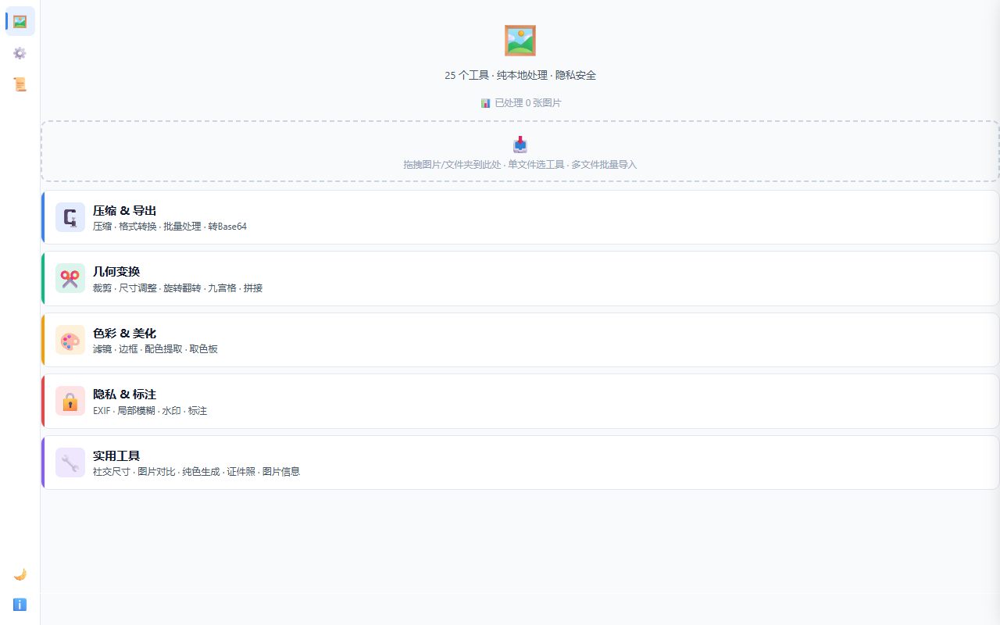
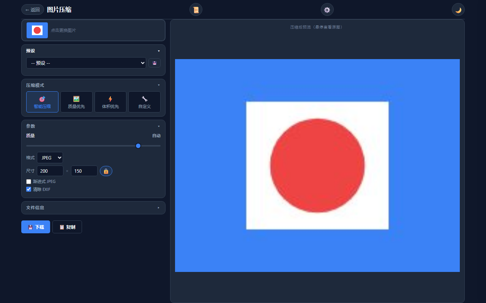
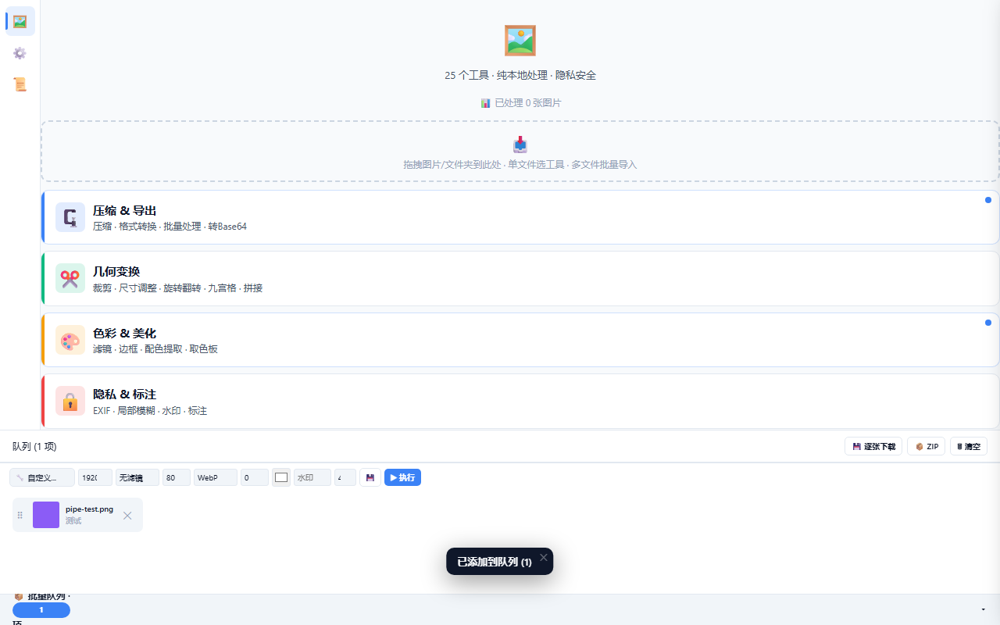

# 图片工具箱

> 纯浏览器端图片处理工具，**28 个工具、19 套主题**，单文件、零安装，图片不上传。
>
> 独立仓库：<https://github.com/Luo-Feng6/image-toolbox>

## 背景与目标

- 场景：评优材料、文档配图、社交平台发图，图片处理需求每周都出现
- 原来的做法：每次开不同网站或软件，重复操作；上传到网站还有隐私顾虑
- 目标：把高频操作收进一个本地页面，双击即用，图片不离开电脑

## 我做了什么

- 需求拆解：统计自己最常用的图片操作，按使用频率分成 5 类
- 方案：纯前端单文件 `index.html`（5973 行），所有处理走 Canvas API
- 关键实现：单文件 + 零框架；CSS 变量主题系统（19 套主题）；localStorage 存设置/历史/预设
- 关键实现：批量队列与流水线预设（压缩 → 滤镜 → 边框 → 水印一键执行）
- 关键实现：28 个社交平台尺寸预设；移动端触屏涂抹（模糊/像素化/标注）

## 结果

- 28 个工具、19 套主题，单文件 5973 行
- 图片全程本地处理，不上传服务器
- 仓库已开源：<https://github.com/Luo-Feng6/image-toolbox>

## 截图







## 技术栈

- 纯 HTML + CSS + JavaScript（无框架）
- Canvas API 处理全部图片操作
- localStorage 持久化（设置 / 历史 / 预设 / 收藏）
- CSS 变量主题系统（深色 / 浅色 / 自动跟随系统）

## 如何运行

```bash
# 方式一：直接双击
index.html

# 方式二：本地静态服务（手机连同一 WiFi 可用）
python -m http.server 8801
```

## 目录结构

```
.
├─ index.html       单文件主程序（全部功能）
├─ start.bat        桌面版启动脚本
├─ .gitignore
└─ README.md
```
