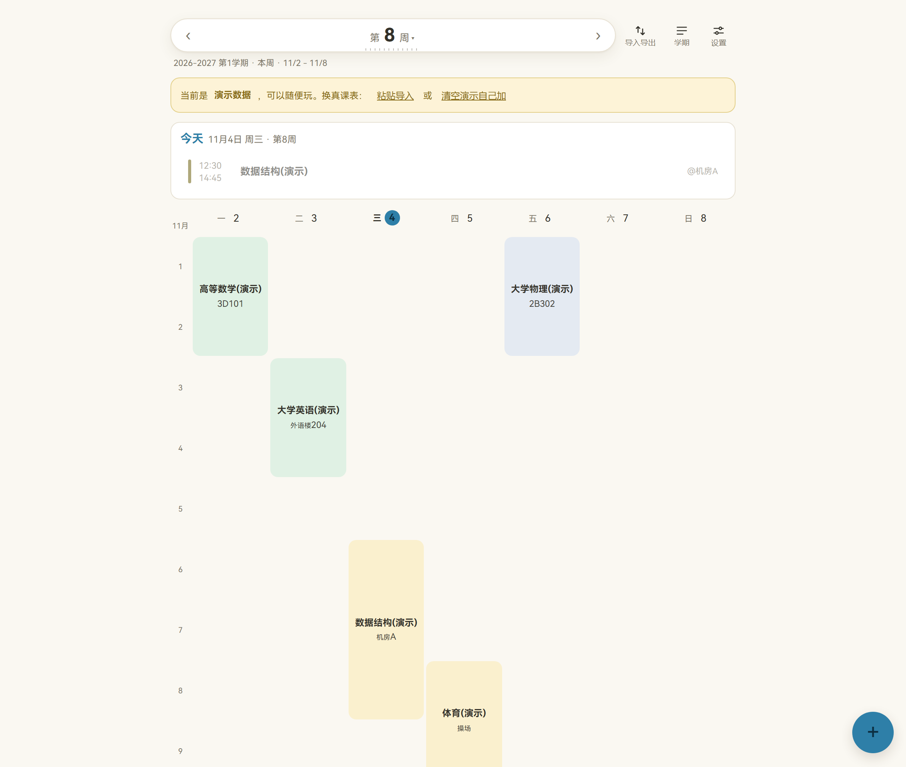
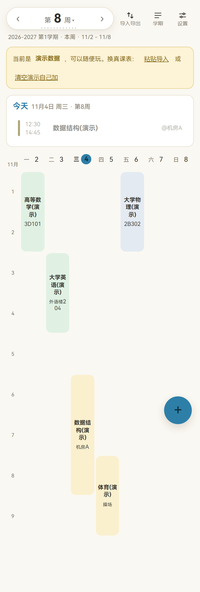

# 海大课程表

> 自用课程表工具：从教务系统导入课表，导出到手机系统日历；单文件 HTML，手机优先。
>
> 独立仓库：<https://github.com/Luo-Feng6/course-table>

## 背景与目标

- 场景：上海海事大学的课表在金智 EAMS 教务网页里；平时主要用手机看课、课前要锁屏提醒、偶尔把课表分享给同学
- 原来的做法：用超级课程表，广告太多
- 目标：无广告、无账号、数据全在本地；手机上打开即用，能从教务导入、也能手动改，能导出 ICS 到系统日历

## 我做了什么

- 需求拆解：按「教务导入 → 周课表 → 日历导出」三条链路拆，先做周视图、手动增删改和备份，再补书签导入与 ICS
- 方案：单文件 `app\海大课程表.html`，原生 HTML/CSS/JavaScript，无框架、无构建链、无外部请求；当前 2,457 行、156,265 字节
- 关键实现：不逆向 CAS 登录。用户手动登录教务、打开课表页后运行书签脚本，脚本读页面已有的全局对象 `table0.activities`（7×13=91 格位，`vaildWeeks` 是 0/1 周次串），合并连续节次后生成课表 JSON，复制到剪贴板并下载文件。应用侧有四条导入入口（教务直达 / 粘贴 / AI 识图 / 文件），也能识别 WakeUp 五行 JSON 和行式文本
- 关键实现：周视图按「周几 + 节次 + 周次」渲染，支持 5/7 天和左右滑动翻周；假期、调休、调课存进学期，由纯函数 `occurrencesFor(date)` 先算「这天实际该上什么课」，周视图、今日卡、ICS、分享图四处统一走它；外观是浅/深主题 × 六套皮肤
- 关键实现：ICS 按天生成事件，带时区声明、RFC 5545 折行、提醒提前量（5/10/15/20 分钟）和可选「闹钟风格」独立事件；未受影响的课沿用旧 UID，重导日历不产生重复
- 关键实现：数据只存 localStorage；支持导出/恢复 JSON 备份，坏数据先留 `.bak`；六处删除点 5 秒内可撤回；有 5 门以上非演示课且 30 天没备份时提醒

## 结果

- 单文件 2,457 行 / 156,265 字节，双击即用，无外部依赖
- 真实教务账号导入 14 门课全部正确，含单双周拆分（同一门课按周次拆成两条记录）和 11-13 节连堂合并
- ICS 导出用 151 节课验证通过
- 2026-10-24 手机开箱实测：iQOO + Edge 手机版打开本地 HTML，添加课程后重开数据仍在，翻周、详情正常
- 桌面浏览器做过全场景验收；截至交接文档最后更新（2026-10-26），唯一没闭环的是手机终版复核
- 个人自用，未发布；使用人数、每周节省时间没有统计

## 截图





导入页、导出日历页：待补。上面两张都是虚构的演示课程，不含真实课表。

## 技术栈

- 原生 HTML + CSS + JavaScript，单文件，无框架、无构建、无外部依赖
- CSS 变量做浅色/深色主题和六套皮肤
- localStorage 持久化（`shmtuSchedule.v1` / `shmtuSchedule.settings`）
- Canvas API 生成本周课表分享图
- 手写 ICS（RFC 5545：TZID、75 字节折行、UID）
- 解析金智 EAMS 页面全局对象 `table0.activities`

## 如何运行

```bash
git clone https://github.com/Luo-Feng6/course-table.git
cd course-table

# 电脑：直接双击 海大课程表.html
# 或起本地静态服务
python -m http.server 8642
```

手机：把 `海大课程表.html` 发到手机，用 Edge 打开（实测 iQOO + Edge 可用）。首次打开是演示数据，右上角「导入」可以粘贴或导入课表 JSON。

## 目录结构

```
.
├─ 海大课程表.html          应用本体（单文件，2,457 行）
├─ 教务课表导出书签.js       教务页面抓取脚本
├─ 示例课表.json            示例数据（虚构课程）
├─ 桌面图标\                添加到手机主屏幕用的图标
└─ index.html              跳转页，供 GitHub Pages 使用
```
